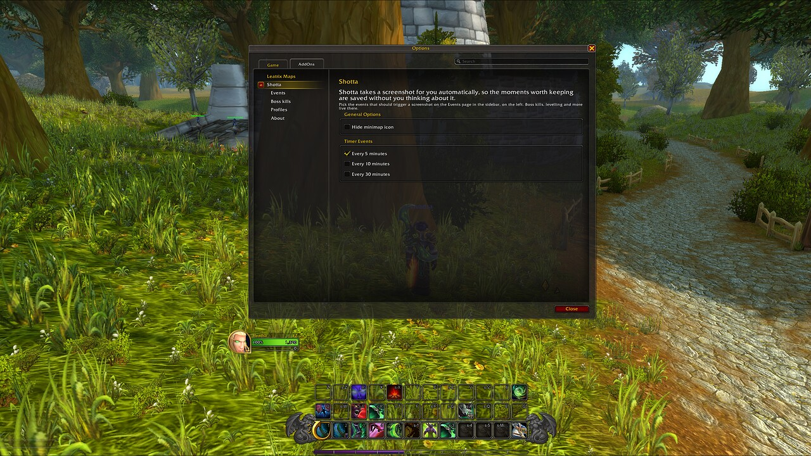
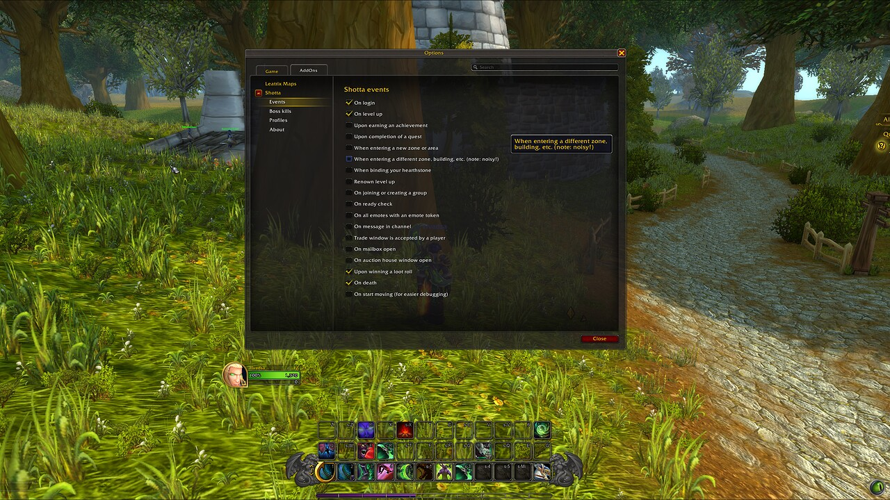
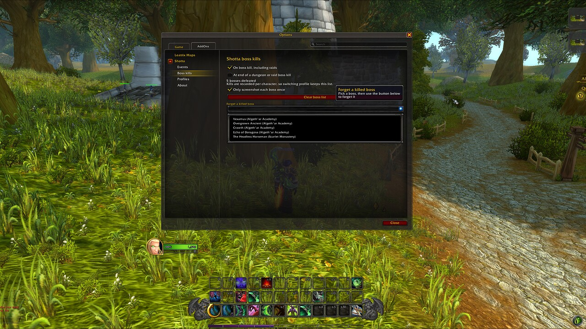

# Shotta

[](https://github.com/martinbjeldbak/shotta/actions/workflows/release.yml)
[](https://github.com/martinbjeldbak/shotta/actions/workflows/lint.yml)

(_screen_)-shotta, mate. Automatically take screenshots of your best moments in
Azeroth so you can keep them forever.



## Shotta Discord

Join the [Shotta Discord server](https://discord.gg/MHqGRpZxbB) to share your
best screenshots, suggest features, or just chat.

## Features

Shotta takes screenshots for you automatically, so the moments worth keeping
are saved without you thinking about it. Each event can be toggled on its own:

- levelling up, quest completions and reputation/renown gains
- achievements, loot rolls and hearthstone binds
- boss kills, including first kills and raid encounters
- entering a new zone or area
- ready checks, trade windows and group formation
- emotes, mailboxes, auction houses and chat channels
- death
- on a timer: every 5, 10 or 30 minutes

Screenshots include the interface by default. You can also take one on demand
from the minimap button: click it for a screenshot without the UI, or
control-click it to include the UI.

Every library is embedded, so there is nothing else to install. New events are
added regularly and suggestions are very welcome via GitHub issues or Discord.

Shotta supports Retail, Forever, Mists of Pandaria Classic, Classic Era, and
Burning Crusade Classic Anniversary.

Screenshots are saved to the `Screenshots` folder inside the game installation
for the client you are playing:

| Client | Folder |
| --- | --- |
| Retail | `_retail_/Screenshots` |
| Forever | `_camelot_/Screenshots` |
| Mists of Pandaria Classic | `_classic_/Screenshots` |
| Classic Era | `_classic_era_/Screenshots` |
| Burning Crusade Classic Anniversary | `_anniversary_/Screenshots` |

On Windows these live under `C:\Program Files (x86)\World of Warcraft\`, and on
macOS under `/Applications/World of Warcraft/`.

## Installing

Shotta is available from:

- [CurseForge](https://www.curseforge.com/wow/addons/shotta)
- [WoWInterface](https://www.wowinterface.com/downloads/info26687-Shotta.html)
- [Wago Addons](https://addons.wago.io/addons/shotta)

### WoWUp

[WoWUp][WoWUp] is a great open-source addon manager. Once installed, open
`Get Addons`, then search for "Shotta", or choose `Install from URL` and paste
<https://github.com/martinbjeldbak/shotta> before clicking `Import`:


Click `Install` and you're done — you will be prompted about future updates. See
the [WoWUp guide][wowup-get-addons] for details.

## Usage

After logging in, Shotta prints a loaded message to chat:


Type `/sh` or `/shotta` to open the options. Shotta has its own page in the
standard addon options: a settings page, the events list, boss kill handling and
profiles.



On the **Events** page you tick the events that should take a screenshot. Hover
over an option to see what it does — this is also how you check whether a nested
option only applies while its parent event is enabled.

Under **Boss kills** you can have each boss screenshotted only the first time you
defeat it. Kills are remembered per character, and any boss can be forgotten from
the list so that its next kill counts as a first kill again:



Once configured, Shotta takes a screenshot the next time each event happens. For
a level up, for example, you get a confirmation:


...followed by a screenshot like this:


## Contributing

Thanks for helping out! The most useful contributions are:

- filing feature requests, bugs and general issues via
  <https://github.com/martinbjeldbak/shotta/issues/new>
- code contributions
- translation strings for each supported language

> If you want to run this addon from a local checkout, symlink the cloned
> repository directory into your `Interface/AddOns` folder following
> <https://wowpedia.fandom.com/wiki/Symlinking_AddOn_folders>. You then only
> need `/reload` to see your changes.

### Development

Shotta targets the WoW Lua 5.1 sandbox. The libraries in `Libs/` are vendored
and refreshed by the packaging tool at release time, so do not edit or format
them.

Recommended tooling:

- [LuaLS](https://luals.github.io/) with the [WoW API extension](https://marketplace.visualstudio.com/items?itemName=Ketho.wow-api)
  for API completion and type checking. `.luarc.json` configures Lua 5.1,
  disables libraries that are unavailable in the game, and ignores `Libs/`.
- [StyLua](https://github.com/JohnnyMorganz/StyLua) for formatting
  (`.stylua.toml`; `Libs/` is ignored via `.styluaignore`).
- [Luacheck](https://github.com/lunarmodules/luacheck) and
  [Selene](https://github.com/Kampfkarren/selene) for linting.

Tool versions are pinned in `.mise.toml` and managed by
[mise](https://mise.jdx.dev/). `just` is pinned there too.

```sh
mise install         # or: just setup
just lint            # luacheck, selene, StyLua, and justfile formatting
just check           # lint plus actionlint for the workflows
just fmt             # format Lua sources with StyLua
```

The recipes invoke `mise exec` internally, so they use the pinned tools even
without shell activation. If `just` is not on your `PATH` yet, run
`mise exec -- just lint`.

The underlying commands are also available directly:

```sh
mise exec -- luacheck .
mise exec -- selene .
mise exec -- stylua --check .
```

`just doctor` verifies mise and the pinned tools are available. CI installs the
same `.mise.toml` tools and runs `just check` on every pull request. Renovate
keeps both the tool pins and GitHub Actions up to date (see `renovate.json`).

### TODO

- [x] Ability to hide/show minimap icon
- [ ] Ability to take 2 screenshots for every event: 1 with UI, 1 without
- [ ] Setting to take screenshots with or without UI
- [ ] More translation strings, see `localization.enUS.lua`
- [ ] UI Button: Reset state to default
- [x] Profiles via AceDB (per-character/profile settings)
- [x] [Timer](https://wowpedia.fandom.com/wiki/API_C_Timer.After) after ie 10s after readcheck
- [x] Add slash command to open up options (if possible?)
- [x] ~~Consider using [AceDB](https://www.wowace.com/projects/ace3)~~ too complicated, extra dependency
- [ ] Make event success printing an option. Currently always printing to chat
- [x] Create a better options frame - Could be 2 columns of events in case of too many events
- [x] If simpler: Implement the settings UI (+ more) using [Ace3](https://www.curseforge.com/wow/addons/ace3)

### Event ideas

not sure if any of these are possible

- [x] Boss/Rare/elite kills
- [x] Every 5/10/30 minutes
- [x] On death
- [ ] When joining a party (with a friend)
- [ ] When close to a friend
- [ ] When emoting with a friend/target
- [x] When emoting at all
- [ ] Low health
- [x] Trade windows
- [ ] More customizable every x minutes with [slider](https://wowpedia.fandom.com/wiki/API_Slider_SetStepsPerPage)
- [ ] Reputation level ups ([event](https://github.com/AtheneGenesis/Vanilla_enUS_FrameXML/blob/master/GlobalStrings.lua#L1944))
- [ ] PvP: Arena endings
- [ ] PvP: Battleground endings
- [ ] PvE: Mythic+ dungion runs

Full event list [here](<https://wowwiki-archive.fandom.com/wiki/Events_A-Z_(full_list)>)

### Consider events

- [`CHAT_MSG_BN_INLINE_TOAST_ALERT`](https://wowpedia.fandom.com/wiki/CHAT_MSG_BN_INLINE_TOAST_ALERT)
- [`CHAT_MSG_LOOT`](https://wowpedia.fandom.com/wiki/CHAT_MSG_LOOT)

## Resources

- [WoW API](https://github.com/Gethe/wow-ui-source)
- [Events](https://warcraft.wiki.gg/wiki/Events)

### Similar addons

- [Memoria](https://www.curseforge.com/wow/addons/memoria), simpler triggers
- [Multishot](https://www.wowinterface.com/downloads/info9590-MultishotScreenshot.html), not updated since april 2015

[WoWUp]: https://wowup.io/
[wowup-get-addons]: https://wowup.io/guide/get-addons/overview
